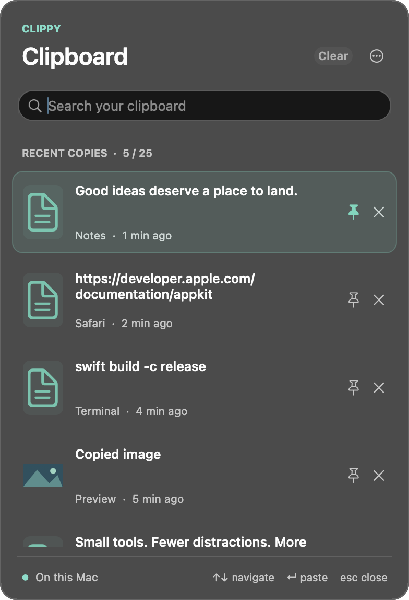

# Clippy

**Your clipboard, with a memory.**

A small, native clipboard history app for macOS, inspired by Windows **Win + V**.
Press **⌥V**, search your recent copies, and press **Return** to paste.

Swift + AppKit · macOS 13+ · No third-party dependencies · MIT licensed



## Features

- **25 recent copies**, with pinned favorites protected from automatic cleanup.
- **Text, rich text, images, and file references**, including multi-item copies.
- **Search as you type** by copied text or source app.
- **Keyboard controls** for navigation, pasting, pinning, and deletion.
- **Local persistence** that survives restarts.
- **Direct pasting** into your current app after Accessibility approval.
- **Pause and launch-at-login controls** in the menu bar.
- **Offline operation**: no accounts, analytics, cloud sync, or update service.

## Install from source

The current release is a **source release**. Local and CI builds are ad-hoc signed;
they are not notarized distribution builds. See [release signing](docs/RELEASING.md).

You need macOS 13 or later and Apple's Command Line Tools with Swift 5.9 or newer.
Full Xcode is optional.

```sh
git clone https://github.com/v3nompro/Clippy.git
cd Clippy
./scripts/build.sh
```

Move `dist/Clippy.app` to **Applications**, then open it. Install it in its final
location before granting permissions. Clippy appears in the menu bar and opens
its picker on the first launch.

The build targets your Mac's architecture. The CI workflow builds and checks
Apple Silicon and Intel variants separately.

## Enable direct pasting

Click **Enable** in Clippy, then allow it in:

**System Settings → Privacy & Security → Accessibility**

On newer macOS versions, this pane is named **Device Control and Data Access**.
Clippy uses this access to send the paste command to your current app and to
position the picker near the text cursor when supported.

Clipboard history works without it: selecting an item copies it, and you can
press **⌘V** yourself. Clippy does not grant or reset permissions automatically.

If the switch is already on but Clippy still asks, follow the
[permission troubleshooting steps](docs/TROUBLESHOOTING.md#permission-is-on-but-clippy-still-asks).
Rebuilding an ad-hoc-signed app changes its identity and can invalidate an older grant.

## Keyboard shortcuts

| Action | Shortcut |
| --- | --- |
| Open or close clipboard history | **⌥V** |
| Search | Start typing |
| Select previous or next item | **↑ / ↓** |
| Paste selected item | **Return**, or click its row |
| Paste filtered item 1–9 | **⌘1 … ⌘9** |
| Pin or unpin selected item | **⌘P** |
| Delete selected item | **⌘⌫** |
| Close without pasting | **Escape** |

Pin and delete buttons are also available on each row. **Clear** removes unpinned
items. The **…** menu includes pause, launch at login, delete all history, and quit.

While Clippy runs, **⌥V** replaces that key combination's normal character. If
another app already owns the shortcut, open Clippy from the menu bar instead.

## Privacy

Clipboard history stays in `~/Library/Application Support/Clippy/History.sqlite`.
The app restricts the directory and database to your account. History is not
separately encrypted; your account security and FileVault remain relevant.

Clippy skips clipboard types marked as confidential or transient, excludes several
common password-manager apps, and pauses capture during macOS Secure Input.
Unmarked secrets copied from ordinary apps can still be recorded. You can pause
capture or delete history at any time.

File entries store references, not the files' contents. The app has no network
client or update checks. macOS Universal Clipboard, backups, and other apps operate
independently. Read the [privacy details](PRIVACY.md).

## Limits

- **4 MiB per copied item** and a **32 MiB payload budget**. Old unpinned entries
  are evicted first. When pins fill the count or byte budget, new copies are skipped.
- The pasteboard is checked every **250 ms**. Very rapid copies can be missed;
  unsupported and oversized content is skipped.
- Search indexes the first **100,000 characters** per entry.
- Some secure fields, remote desktops, and apps that reject simulated **⌘V** may
  require manual pasting. An app can ignore a paste event even after it is sent.
- No Windows cloud history, emoji/GIF picker, OCR, or cross-device synchronization.

## Development

```sh
./scripts/check.sh       # Core checks using temporary, private pasteboards
./scripts/package.sh     # Build an app, ZIP, and SHA-256 checksum

# Sample content only; no capture, global shortcut, or permission requests.
open -n dist/Clippy.app --args --preview
```

The check runner works with Command Line Tools alone; XCTest is not required.
The build scripts use SwiftPM's native build system for compatibility with both
Command Line Tools and Xcode installations.

See [contributing](CONTRIBUTING.md), [testing](docs/TESTING.md), and
[release preparation](docs/RELEASING.md). Report bugs through
[GitHub Issues](https://github.com/v3nompro/Clippy/issues); keep clipboard contents
and databases out of reports. For sensitive issues, see [security](SECURITY.md).

## License

[MIT](LICENSE). Copyright © 2026 Clippy contributors.
